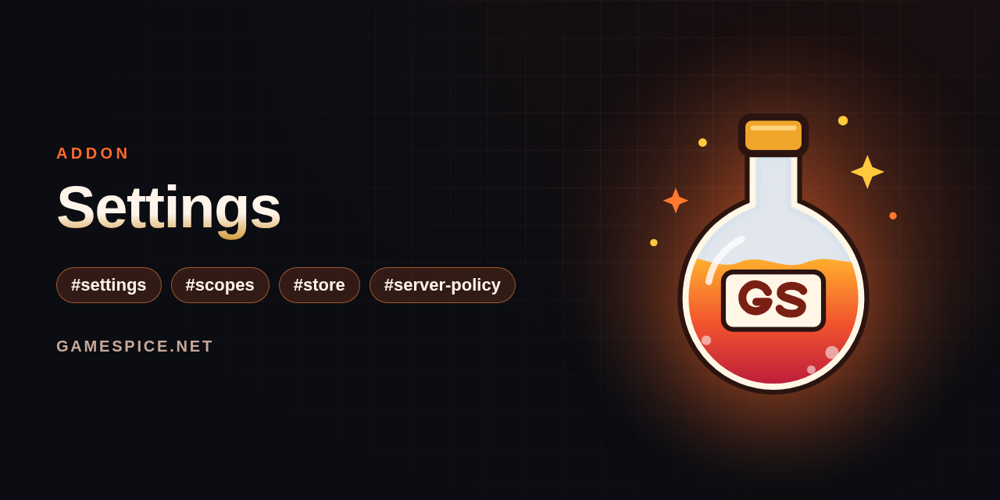

[](https://moddingcommunity.com/a/43-gs-settings)

Game settings as a validated document: declare each setting once, scope it to a device, an account or a server, and save it through a store you choose. A settings screen, a console and a migration all read the same declaration.

GameSpice addon, MIT, built with Claude Code. `examples/settings_selftest.tscn` is the headless test. Every game in [Zee's Games](https://zeesgames.com) keeps its settings through this addon on live servers. Bug reports go to the [issue tracker](https://github.com/gamespice-platform/settings/issues).

## Install

1. Get [Godot 4.7](https://godotengine.org/download).
2. Either use [GameSpice Bootstrap](https://github.com/gamespice-platform/bootstrap), which clones every project and links the addons, or copy `addons/gs_settings/` and [GameSpice Core](https://github.com/gamespice-platform/core)'s `addons/gs_core/` into your project and enable gs-settings in *Project > Project Settings > Plugins*.

GameSpice Core and [GameSpice Save](https://github.com/gamespice-platform/save) (copy its `addons/gs_save/` beside `gs_core`) are the dependencies.

## Use

```gdscript
var schema := GSSettingsSchema.new()
schema.add(GSSettingsDef.number(&"master_volume", 0.8, 0.0, 1.0, &"audio"))
schema.add(GSSettingsDef.integer(&"fov", 90, 70, 120, &"video")
    .with_scope(GSSettingsDef.Scope.SERVER_CLAMPED))
schema.add(GSSettingsDef.binding(&"chat_open_key", "Y", &"chat")
    .with_scope(GSSettingsDef.Scope.ACCOUNT))

var settings := GSSettingsManager.new()
settings.schema = schema
settings.local_store = GSSettingsStoreFile.new()
settings.app_namespace = &"my_game"
settings.shared_namespace = &"tmc_account"      # optional
add_child(settings)
settings.setup()

settings.get_float(&"master_volume")
settings.set_value(&"master_volume", 0.4)       # saved shortly after, atomically
```

A key binding is stored as readable text (`"Y"`, `"Shift+A"`, `"Mouse 1"`), not a keycode, so the file means the same on every keyboard layout. GameSpice UI's `GSInputBinding` converts it to and from an `InputEvent`.

## Scopes

| Scope | For | Behaviour |
| --- | --- | --- |
| `DEVICE` | Resolution, audio device, thread count | Never synchronised, so switching machines does not break it. |
| `ACCOUNT` | Sensitivity, crosshair, subtitles, language | Stored under `shared_namespace`. Games that use the same name share the value; others are unaffected. |
| `SERVER_CLAMPED` | Field of view, view models, third person | A server may cap it. |

## Server clamps

A server can cap a setting but can never read one: asking clients for key bindings, audio device or resolution would build a fingerprint that survives new accounts and bans, so this addon has no read direction at all.

A clamp is a bound, not a value. What is saved is the player's choice.

```gdscript
settings.apply_server_clamps({"fov": 90})
settings.get_value(&"fov")      # 90 for a player who wanted 110
settings.chosen_value(&"fov")   # 110, what the screen shows
```

## Settings screen

`GSSettingsManager.to_config()` returns a `GSConfig` whose properties are the schema's keys. GameSpice UI builds a panel from any `GSConfig`, so you do not write one.

## Saving

| Behaviour | Why |
| --- | --- |
| Written on change, debounced | Dragging a slider is one write, and a crash loses nothing. |
| Atomic (temporary file, then rename) | A crash mid-write cannot corrupt the file. |
| Web builds flush the IndexedDB mirror after every write, removals included | `user://` on the web is only a mirror. |
| Unknown keys are kept and written back | Going back to an older build does not lose settings a newer one added. |
| A bad hand-edit loses one line | An out-of-range value is corrected, an unreadable one falls back to the default, and the two are reported separately. |

## Stores

`GSSettingsStore` has three methods. A file store and a memory store ship. An account store is an HTTP client against whichever back end you use; this addon does not choose it for you.

## Testing

Import the project once, then run the self-test scene in `examples/` headless with Godot. Design notes: [docs/design.md](docs/design.md).

## Used by

All of these games from Zee's Games vendor this addon:

- [Fatal Contact](https://zeesgames.com/fatal-contact)
- [Airdrift](https://zeesgames.com/airdrift)
- [Playlot](https://zeesgames.com/playlot)
- [Hungario](https://zeesgames.com/hungario)
- [Buses From Hell](https://zeesgames.com/buses-from-hell)
- [Smash Copter](https://zeesgames.com/smash-copter)
- [Zombie Zone](https://zeesgames.com/zombie-zone)
- [Hide n Seek](https://zeesgames.com/hide-n-seek)
- [Prop Hunt](https://zeesgames.com/prop-hunt)
- [Murder Mystery](https://zeesgames.com/murder-mystery)
- [Deathrun](https://zeesgames.com/deathrun)
- [Wipeout](https://zeesgames.com/wipeout)
- [Dangerous Delivery](https://zeesgames.com/dangerous-delivery)
- [Look At Me](https://zeesgames.com/look-at-me)

The whole collection is at [zeesgames.com](https://zeesgames.com).

## Licence

MIT licence, see [LICENSE](LICENSE). The only closed part of the [**GameSpice**](https://gamespice.net) platform is the web back end; you can use your own instead of GameSpice's.
